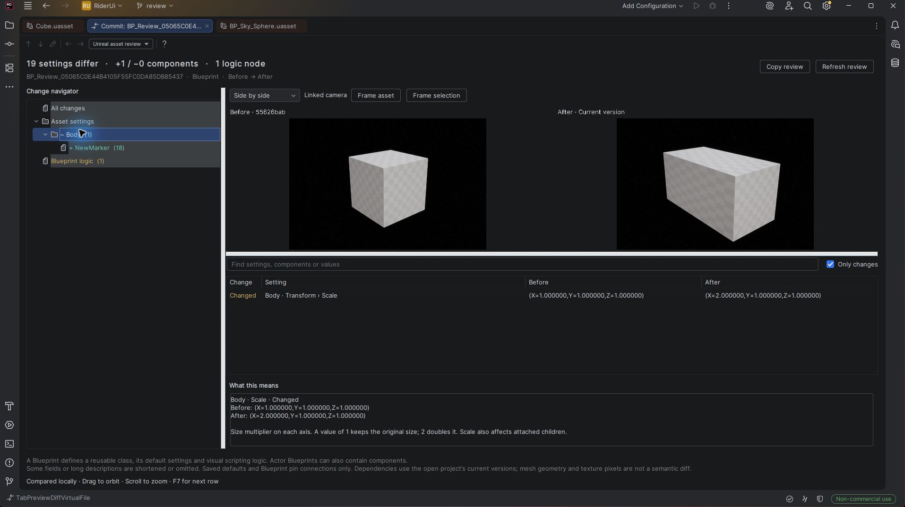
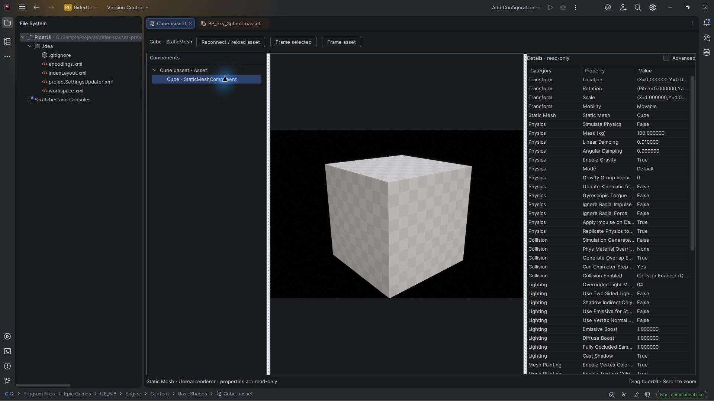

# Rider UAsset Viewer

Understand Unreal assets and their changes inside JetBrains Rider: linked before/after viewports, component and setting differences, Blueprint logic changes, and readable explanations.

This is an early prototype with two plugins: a Java plugin for Rider and a companion C++ editor plugin for Unreal Engine. **The Unreal project must be open in Unreal Editor.** Standalone `.uasset` parsing is not supported.



## Features

- **Actor Blueprints:** inspect component templates, attachments and inherited components. Select a component in the tree to see its default properties.
- **Static meshes:** 3D preview using Unreal's renderer.
- **Skeletal meshes:** 3D preview in the reference pose.
- **Texture2D:** image preview, up to 2048 pixels, and asset properties.
- **Viewport controls:** drag to orbit, scroll to zoom, and use **Frame selected** or **Frame asset** to focus the camera.
- **Details:** editor-visible properties with Unreal display names. Advanced properties are hidden by default and can be enabled with **Advanced**.
- **Native Git/Commit diffs:** compare the actual before and after asset bytes, including added and deleted assets. Blueprint components are matched using their persistent IDs where available.
- **Visual review:** linked cameras use shared bounds so size/position changes stay visible. Switch between side by side, a wipe, before, after and a pixel-difference view.
- **Readable change lists:** find a component or setting, filter to changes, read the setting's meaning and copy a review to the clipboard.
- **Blueprint logic:** compare node defaults, serialized node settings and pin connections. Layout and node comments are excluded.
- **Other asset classes:** inspect editor-visible settings even when the asset has no 3D geometry.



## Requirements

The prototype has been built and tested with:

- Windows x64.
- JetBrains Rider **2025.3.5.3** and **2026.2.4.1**, with the bundled compiler. Release binaries use Java 21 bytecode.
- Unreal Engine **5.8.4**, with a working Windows C++ build toolchain.
- PowerShell **7** (`pwsh`). The build scripts use APIs unavailable in Windows PowerShell 5.1.

The Rider plugin declares build **253 through 262.*** compatibility (Rider 2025.3–2026.2). See [compatibility and IDE upgrades](docs/COMPATIBILITY.md) for verified builds and upgrade instructions. Other Unreal versions and operating systems have not been validated.

## Build from source

Run these commands from the repository root in PowerShell 7:

```powershell
pwsh
.\scripts\Build-Rider.ps1 -Test
```

This compiles the Rider plugin and runs its HTTP transport checks. It produces `dist/unreal-asset-preview-0.2.1.zip`. Rider libraries are used from your local installation and are not bundled with the plugin. No Gradle or additional JDK download is required. Build release binaries against the oldest supported Rider installation, then verify the same ZIP against newer IDE builds.

If Rider is installed elsewhere, pass its installation directory:

```powershell
.\scripts\Build-Rider.ps1 -RiderHome 'D:\Tools\Rider' -Test
```

Save your work and close Unreal Editor and Live Coding before building the Unreal plugin:

```powershell
.\scripts\Build-Unreal.ps1 -EngineRoot 'C:\Program Files\Epic Games\UE_5.8'
```

The script creates an isolated project under `build/` and prints the compiled plugin directory under `dist/`. It stops with exit code `20` if an Editor or Live Coding process is running. It never closes your existing sessions or modifies your Unreal project.

For an existing isolated host, `-AllowOtherProjects -HostProject '...AssetPreviewHost.uproject'` permits work alongside another project after checking the host's location, project descriptor, process command lines and loaded Editor DLL paths. The host itself must be closed. Builds still use `-NoEngineChanges` and `-NoHotReloadFromIDE`; unverifiable isolation stops the operation.

## Read an asset diff

1. Open a two-way `.uasset` diff from Rider's **Commit** or **Git History** view. If needed, choose **Unreal asset review** in the diff viewer selector.
2. Read the summary, then select **All changes**, an individual component, or **Blueprint logic** in the change navigator.
3. Compare the linked viewports. Drag to orbit and scroll to zoom. In **Wipe**, use the slider or **Shift + drag** to move the boundary.
4. Select a changed setting to see **Before**, **After** and **What this means**. Search accepts component names, settings and values. **F7** moves to the next displayed row; **Ctrl + F** focuses search.
5. Use **Copy review** to share a text summary. The viewer never applies changes or saves assets.

A Blueprint is a reusable class. A component is one of its parts, such as a camera, collision shape or mesh. A mesh provides the shape; a material provides its surface appearance. A parent class supplies inherited behavior and defaults, while an attachment parent controls how a component follows another component's transform.

**Review scope matters.** Historical assets are loaded separately using Unreal's revision loader, but dependencies and native classes come from the currently open project. This is not a checkout of the whole historical project. Settings comparisons cover editor-visible saved defaults and the exported Blueprint node data, not every binary field. A pixel mask is a visual aid, not a semantic geometry comparison. Long values use full normalized fingerprints, with a bounded readable preview; limits are shown in the review. See [review architecture and coverage](docs/ASSET_REVIEW.md).

Git LFS pointers are resolved only from verified local LFS objects. If the historical object is missing, the viewer tells you to fetch it; it never substitutes the current working asset for the missing revision. Assets larger than 128 MB and three-way merge/conflict resolution are outside this release's review support.

## Install from a GitHub Release

Release downloads become available after a release with all distribution files has been published. Pushing the source repository alone does not create an installable release.

### One-command installation

Close Rider, Unreal Editor and Live Coding. In **PowerShell 7**, run the following line, replacing the project path:

```powershell
Invoke-WebRequest 'https://github.com/kaan1altay/rider-uasset-preview/releases/latest/download/Install.ps1' -OutFile "$env:TEMP\Install-RiderUAssetViewer.ps1"; & "$env:TEMP\Install-RiderUAssetViewer.ps1" -Project 'D:\Games\MyGame\MyGame.uproject'
```

The installer downloads a published release, verifies ZIP sizes and SHA-256 hashes, installs the Rider plugin and the Unreal companion, and enables the companion in the chosen `.uproject`. It never closes applications for you. Existing plugin directories and the original project descriptor are backed up under `%LOCALAPPDATA%/RiderUAssetViewer/Backups/`; failed installs restore the previous directories. The original project descriptor is restored on rollback.

The default Rider location is `%LOCALAPPDATA%/Programs/Rider`. The standard plugin profile is derived from that installation’s `product-info.json`, for example `%APPDATA%/JetBrains/Rider2026.2/plugins`. For Toolbox, another installation or a custom profile, pass `-RiderHome` and, if necessary, `-RiderPluginsDirectory`. Pass `-EngineRoot` for another Unreal installation. The prebuilt companion requires the exact Unreal version **and build ID** recorded in the release; otherwise build from source.

After downloading the installer, you can also use:

```powershell
# Inspect and validate a release without installing it.
& "$env:TEMP\Install-RiderUAssetViewer.ps1" -Project 'D:\Games\MyGame\MyGame.uproject' -WhatIf
# Install only one companion, or pin a release.
& "$env:TEMP\Install-RiderUAssetViewer.ps1" -RiderOnly -Version '0.2.1'
& "$env:TEMP\Install-RiderUAssetViewer.ps1" -UnrealOnly -Project 'D:\Games\MyGame\MyGame.uproject'
```

`-WhatIf` still downloads and validates packages in temporary staging, but does not change plugin directories or the project. GitHub downloads currently require a publicly accessible release. The installer does not run UBT or change PowerShell execution policies.

### Install and update through Rider

In **Settings → Plugins → gear menu → Manage Plugin Repositories**, add:

```text
https://github.com/kaan1altay/rider-uasset-preview/releases/latest/download/updatePlugins.xml
```

Then search for **Unreal Asset Preview** in the Plugins page and install it. This uses JetBrains' [custom plugin repository format](https://plugins.jetbrains.com/docs/intellij/custom-plugin-repository.html). A normal GitHub repository URL cannot be used in its place.

With Rider closed, the Rider plugin can also be installed using its [command-line installer](https://www.jetbrains.com/help/rider/Install_plugins_from_the_command_line.html):

```powershell
& "$env:LOCALAPPDATA\Programs\Rider\bin\rider64.exe" installPlugins dev.kaan.uassetpreview https://github.com/kaan1altay/rider-uasset-preview/releases/latest/download/updatePlugins.xml
```

**Rider's plugin manager installs and updates only the Rider half.** Install or update the matching Unreal companion separately with `Install.ps1 -UnrealOnly -Project '...uproject'`, or use the full installer to update both. The installer prints the repository URL but does not edit Rider's repository settings.

### Manual installation / source builds

1. Copy the compiled Unreal plugin directory printed by the build script to `<YourProject>/Plugins/RiderAssetPreview/`. `RiderAssetPreview.uplugin` must be directly inside that directory.
2. Open the project in Unreal Editor. Enable **Edit → Plugins → Rider Asset Preview** and restart the Editor if requested.
3. In Rider, use **Settings → Plugins → gear menu → Install Plugin from Disk** and select `dist/unreal-asset-preview-0.2.1.zip`. Restart Rider if requested.
4. Open the same project in Rider and Unreal Editor. Check the Unreal Output Log for `Asset preview bridge ready`.
5. Open a supported `.uasset` file in Rider. Select components in the tree to inspect their properties.

After changing and compiling an asset in Unreal, use **Reconnect / reload asset** in Rider to create a fresh preview. There is no automatic live synchronization.

Build outputs are excluded from Git. Published releases contain the ZIPs, installer, integrity manifest and repository XML. See [release preparation](docs/RELEASING.md) to create them.

## How it works

The Rider plugin discovers the running Editor through `Saved/RiderAssetPreview/session.json` in the project. The Unreal plugin loads the asset, creates a separate preview scene and provides its hierarchy, Details data and PNG frames over an authenticated loopback HTTP connection.

Details are exported through Unreal's `PropertyEditor` model, respecting its visibility rules and display names. They are presented as a read-only table in Rider. Custom Slate controls, action buttons and event creation are not reproduced.

The viewport requests 960 × 640 PNG frames when the camera changes. Requests are coalesced at 100 ms intervals, but rendering, readback and PNG compression still run on the Editor game thread. This is an inspection viewport; smooth real-time frame rates are not guaranteed.

## Current limitations

- Blueprint previews use component template defaults. Construction Script, BeginPlay, PIE and physics simulation are not executed. Runtime changes and components generated by Construction Script are not represented.
- Child Actor components can be inspected, but their child actors are not spawned.
- Skeletal animation playback, a full Blueprint graph editor, maps (`.umap`), asset editing and saving are not supported. Blueprint logic changes are available as a read-only review list.
- Selection is through the component tree; clicking geometry in the viewport does not select it.
- Complex inherited/native component override combinations and project-specific custom components need further testing. Visual parity with the full Blueprint Editor is not guaranteed.
- Texture2D and skeletal mesh previews have passed Unreal HTTP/render tests; separate interactive Rider checks for these two asset types remain outstanding.

Assets are loaded by Unreal in the current project. Custom component registration and rendering callbacks may execute; use projects and assets you trust.

## Connection and troubleshooting

- Keep the correct Unreal project open. Rider searches its project directory first, then the asset's ancestor directories, for the bridge descriptor.
- If the Editor was restarted or a preview expired, use **Reconnect / reload asset**. If the bridge is missing, confirm the Unreal plugin is enabled and check the Output Log.
- The default port is `32187`. For a second Editor project, use a different port, for example `-RiderAssetPreviewPort=32188`.
- The server accepts loopback connections with a per-session bearer token. Browser-origin requests are rejected. The bridge will not start if HTTPServer binds its port to a non-loopback address.
- **Do not share or commit `Saved/RiderAssetPreview/session.json`.** It contains the connection token. All Unreal `Saved/` directories are ignored by this repository.
- Up to eight preview sessions can be active at once. Closing a tab releases its session; idle sessions expire after 30 minutes.

See [development and testing](docs/DEVELOPMENT.md) for isolated demos, integration tests and release packaging.

## License

The plugin source is available under the [MIT License](LICENSE). Unreal Engine, JetBrains Rider and their libraries are separate products and are not included in this repository.
