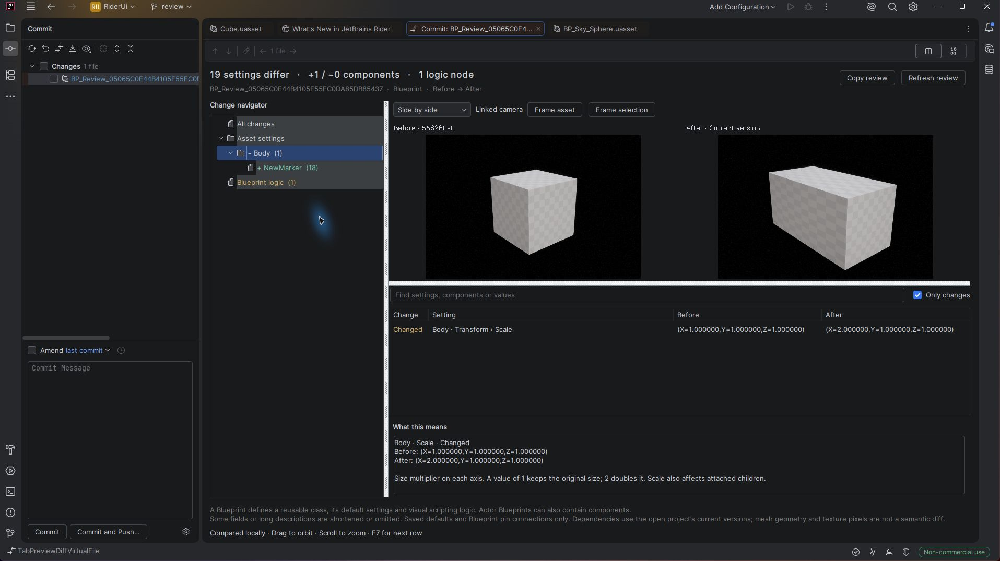

# Rider compatibility and upgrades

## Why Rider reports an incompatible plugin

Rider checks the `since-build` and `until-build` bounds inside the installed plugin and its repository metadata before an IDE upgrade. Version 0.2.0 declared `253` through `253.*` (Rider 2025.3), so Rider correctly warns when upgrading to build 262 (2026.2). That message is a compatibility declaration check, not evidence of a runtime crash.

Version 0.2.1 declares `253` through `262.*`. It keeps Java 21 bytecode and is built against the older supported platform. The installer reads those bounds from the release manifest and requires an exact match with the ZIP's plugin descriptor. Builds below 253 or above 262 remain rejected.

## Updating from 0.2.0

1. In the existing Rider version, update **Unreal Asset Preview** to **0.2.1** from the custom repository, or install the Rider ZIP from the release using **Install Plugin from Disk**.
2. Restart Rider if requested. Reopen the IDE update dialog so it can check the newly installed plugin metadata.
3. Proceed with the Rider upgrade. If Rider has already been updated and disabled 0.2.0, install 0.2.1 in the new IDE and restart it.

The repository remains:

```text
https://github.com/kaan1altay/rider-uasset-preview/releases/latest/download/updatePlugins.xml
```

The 0.2.1 Rider hotfix uses the same version 2 inspection protocol as 0.2.0, so an existing 0.2.0 Unreal companion can remain in place for this hotfix. The paired installer ships a 0.2.1 Unreal package for new or complete installations. Unreal Engine version/build compatibility is unchanged.

## Reproducing binary compatibility checks

The 0.2.1 release ZIP, compiled against Rider 2025.3.5.3, was checked with JetBrains Plugin Verifier 1.411 against **253.33813.106 (2025.3.5.3)** and **262.11879.119 (2026.2.4.1)**. Both verdicts were **Compatible**, with no API-usage or compatibility-warning reports. The intervening 2026.1 branch is within the declared range but has not had a separate interactive check.

The ordinary Java regression suites also pass against both installations. A separate Rider 2026.2.4.1 profile loaded the release plugin and opened the real Git Commit fixture: both viewports rendered, component navigation worked, and the saved scale and Blueprint input changes appeared correctly.



Download the official [JetBrains Plugin Verifier](https://github.com/JetBrains/intellij-plugin-verifier) and verify its published checksum. Supply local Rider installations; this script does not launch an IDE or download dependencies:

```powershell
.\scripts\Build-Rider.ps1 -RiderHome 'C:\Tools\Rider2025.3' -Test
.\scripts\Test-RiderCompatibility.ps1 `
  -RiderHome 'C:\Tools\Rider2025.3','C:\Tools\Rider2026.2' `
  -VerifierJar '.\build\tools\verifier-cli-1.411-all.jar'
```

Reports are written below `build/rider-compatibility-<id>/`. The script checks report files as well as the process exit code; a missing verdict or compatibility problem fails the check. Inspect warnings and API-usage reports too. Binary verification complements real preview/diff UI checks; it does not prove every asset or IDE workflow.

See JetBrains' [build number documentation](https://plugins.jetbrains.com/docs/intellij/build-number-ranges.html) and [compatibility verification guidance](https://plugins.jetbrains.com/docs/intellij/verifying-plugin-compatibility.html).
